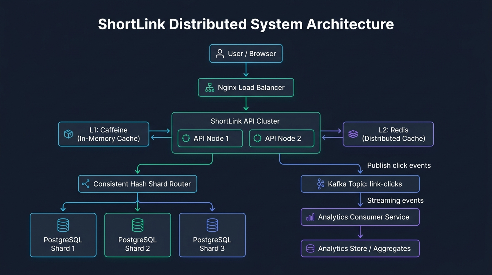

# ShortLink

ShortLink is a production-grade, distributed URL shortening and click-analytics platform built with Spring Boot, PostgreSQL, Redis, Kafka, and Docker.

## Project Status

- **Current Phase**: Phase 1 - Modular Monolith
- **Milestone**: Day 1 - Skeleton & Core Infrastructure
- **Status**: Initial skeleton configured, PostgreSQL 16 container ready, Actuator and Ping endpoints active.

## Architecture



ShortLink is designed as a modular monolith transitioning to an event-driven distributed architecture:

1. **Modular Monolith Foundation**:
   - `com.shortlink.api`: REST endpoints (`/api/v1/links`, `/{shortCode}`, `/api/v1/ping`)
   - `com.shortlink.service`: Core URL shortening and redirection logic
   - `com.shortlink.idgen`: Twitter Snowflake 64-bit ID generator with Base62 encoding
   - `com.shortlink.domain`: JPA entities and repository interfaces
   - `com.shortlink.config`: Infrastructure, database, and security configurations
2. **Upcoming Distributed Components**:
   - Multi-tier caching: Caffeine local cache + Redis distributed cache-aside
   - Async click analytics: Kafka event streaming with an isolated consumer service
   - Scalable data layer: Consistent-hash sharding across multiple PostgreSQL instances
   - Observability: Prometheus metrics, Grafana dashboards, and Actuator health checks

## Benchmarks & Performance Targets

- Redirect Latency: `[N]` ms (Target: p95 `< 10ms`)
- Throughput: `[N]` requests/sec
- Test Coverage: `[N]%`

*(Real benchmark and performance figures will be measured and populated via k6 load tests in subsequent phases.)*

## Prerequisites

- Java 25 (or compatible JDK)
- Docker & Docker Compose
- Maven (or included `./mvnw` wrapper)

## Getting Started

### 1. Start Database Container
```bash
docker compose up -d
```
Check health:
```bash
docker compose ps
```

### 2. Build and Run the Application
```bash
./mvnw clean compile
./mvnw spring-boot:run
```

### 3. Verify Endpoints
- **Health Check**:
  ```bash
  curl -i http://localhost:8080/actuator/health
  ```
- **Ping**:
  ```bash
  curl -i http://localhost:8080/api/v1/ping
  ```

### 4. Run Tests
```bash
./mvnw test
```

